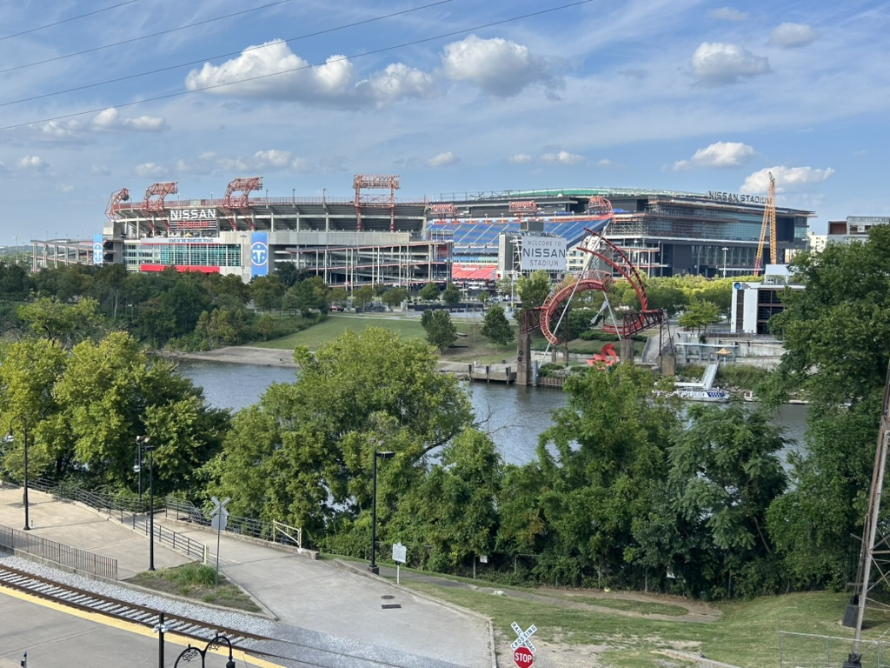
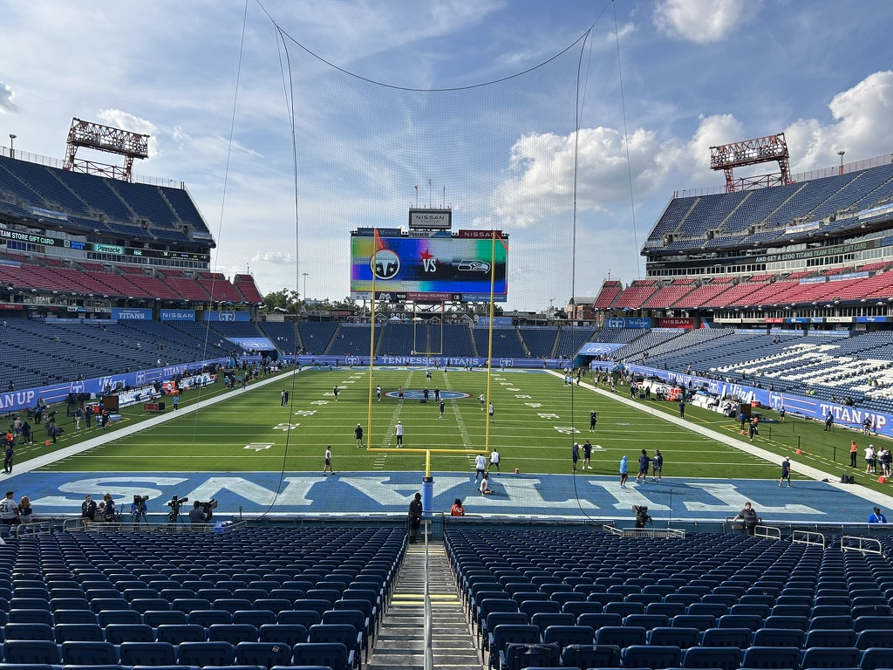
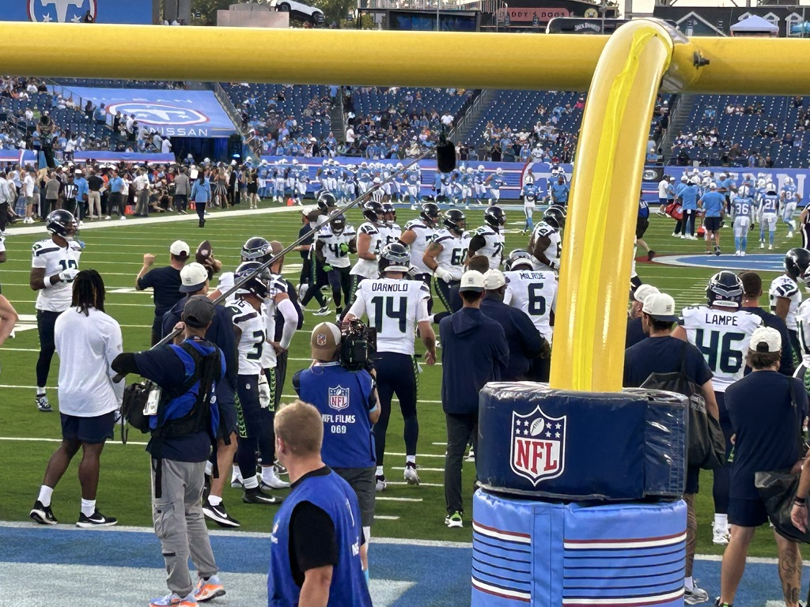
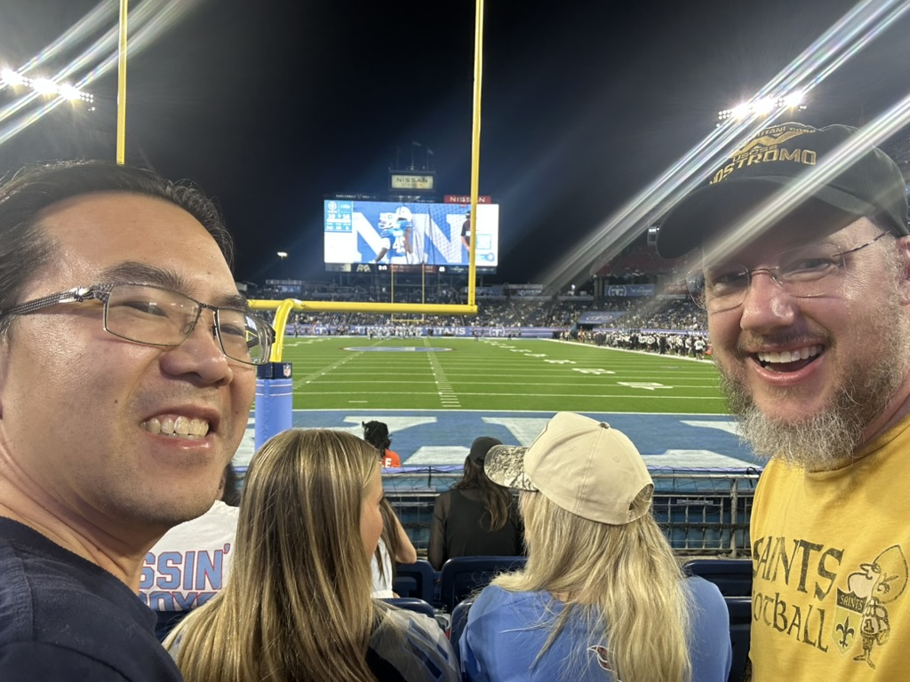
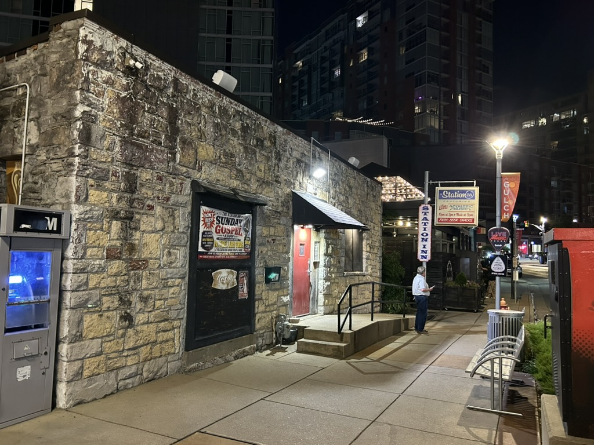
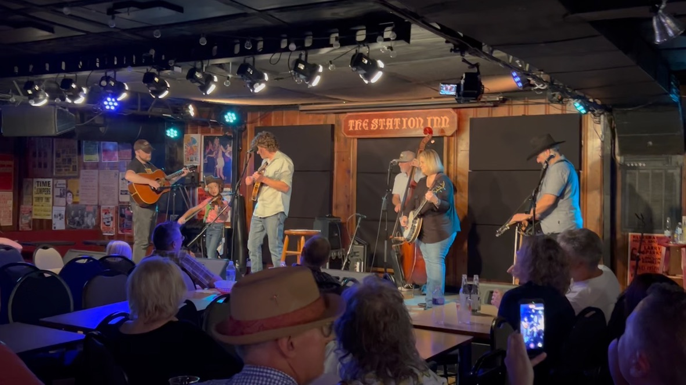
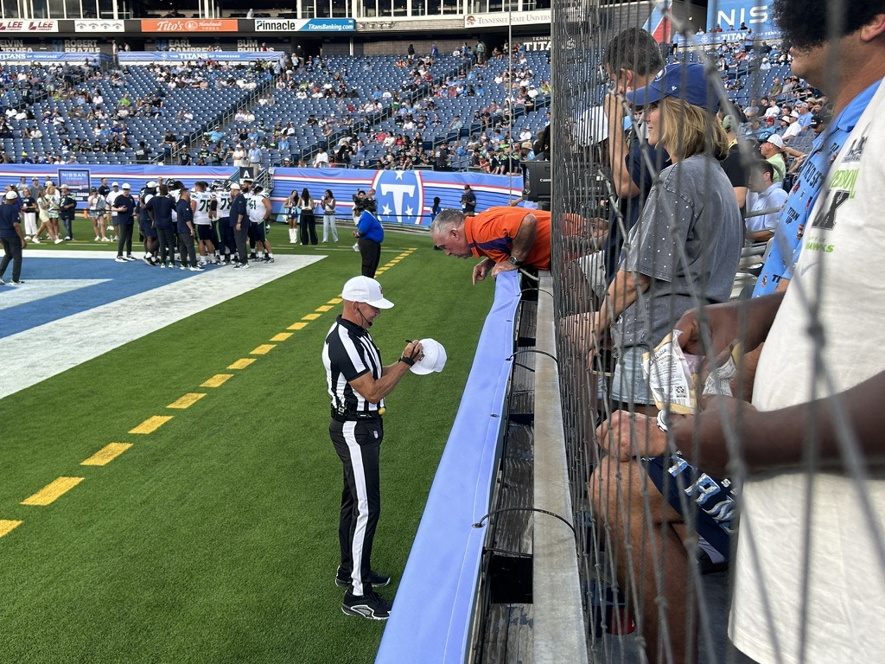

# Stadium #5: Nissan Stadium and Our First Southern Trip
    
**Stadium #5: Nissan Stadium, Nashville, TN**  
*Seahawks vs Tennessee Titans - August 23, 2026*

---

## A Tough Loss in Nashville

We had a tough loss in Nashville a few weeks back.

I was waiting for the latest episode of [HBO's *Hard Knocks*](https://www.hbo.com/hard-knocks) when I heard the news that Dolly Parton had passed away. It put that Seahawks preseason loss, and the whole trip to Nashville, into a different context.

The fates had been kind to Tommy and me. We got to see the Seahawks play the Tennessee Titans in Nashville the day before. We use these trips as an excuse to see every NFL stadium, but also to sample a piece of America one city at a time. This was our first game of the year and our first chance to see my Super Bowl-winning Seahawks start the climb all over again, even if most of the starters were watching from the sideline.

The game was what you would expect from the preseason. There were execution problems, college-level tackling on both sides, and a lot of penalties. Second-, third-, and fourth-string players were fighting for jobs. It was not always great football, but there were glimpses of what the next generation could become.

Since HBO was filming the Seahawks, some of the stories we had seen on TV were now playing out in front of us. Wide receiver Montorie Foster Jr., who had been a substitute teacher at St. Edward High School in Ohio, was making some wild catches while trying to earn one of the final roster spots. That opportunity had opened after Jake Bobo, a fan favorite and our fourth receiver, tore his ACL during a joint practice with the Titans a few days earlier.

Noah Igbinoghene had some strong plays at cornerback, and inside linebacker Chazz Surratt was making tackles against Tennessee's second and third teams. Both were veterans putting everything they had on the field. Only one of them would make the final roster of 53.

I knew nothing about the Titans going into the game, but by the end I was impressed with Julius Chestnut. He seemed unstoppable against our third- and fourth-string defense.

Along with all that effort, we also saw how quickly a season can end. On Seattle's first defensive play, safety Bud Clark suffered a season-ending ankle injury. There was a blur of medics, and the players dropped to their knees around him.

Bud was a second-round pick out of TCU and looked like he could become another force in Mike Macdonald's "Dark Side" defense. From everything I had read after the draft and seen in practice, he belonged on the team. On a roster coming off a Super Bowl win, that was saying a lot. Then his season was over after one play.

That feeling of people trying to prove they belonged was all over Nashville, not only in the stadium.

The day before the game, we walked around downtown and heard exceptional music coming from every direction. Each bar had a cover band that would probably be one of the best bands in almost any other city. We wandered down an alley and found a makeshift stage where a young woman was singing a solo set, hoping to get noticed. There was so much raw talent packed into a few blocks, and a strange line between hope and desperation. Everyone was playing for the opportunity to be found.

That night at the Station Inn, we saw the other side of it: musicians who were ready when their turn came.

The organizer was a silver-haired, old-time banjo player who admitted that the show had been put together at the last minute. That made the performance even more impressive. When they invited guests onto the stage, the first was a 15-year-old singer who came across like she had been doing this for years.

The second was a remarkable 10-year-old fiddle player. His mom had dressed him in a cowboy hat and western shirt, and he had a bright-eyed, slightly bemused look about him. He was the son of one of the bluegrass guitarists. He was fully prepared to play the entire set, and he played like he was one of them.

When I got back to Seattle and heard about Dolly, I kept thinking about all of those people trying to get onto a bigger stage.

Dolly stood apart from the Nashville country music machine because she always seemed to be her genuine self. Football fans sometimes talk as though players are interchangeable. A running back is a running back. A slot receiver is a slot receiver. Seahawks fans have joked for years that we needed "just a guard" or that any running back could get us into the playoffs. Meanwhile, we spent years wandering through the desert looking for a good offensive line, a solid running back, or a quarterback who could get us back to the postseason, let alone another Super Bowl.

Maybe that is too much meaning to put on one messy preseason game. But what stayed with me was how hard everyone was working for a chance, whether they were holding a football or a fiddle. Making it that far takes talent. Staying there means giving people something they cannot get from the next person in line.
